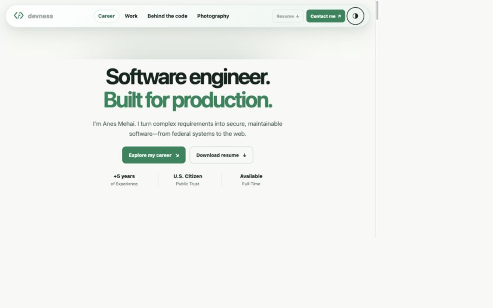

# Appearance control verification

Verified the `apple-design-skill-redesign` branch through a local HTTP preview on October 20, 2026.

- Inspected mobile, intermediate, and desktop header layouts in light and dark mode.
- Confirmed a 44px control and 21px SVG, centered within rounding tolerance.
- Confirmed the control stays inside the header without overlapping navigation.
- Used Space to toggle the native checkbox and confirmed the theme changed with a visible keyboard focus outline.
- No additional code changes were needed after visual inspection.

The screenshot shows the desktop light appearance with keyboard focus on the control.

